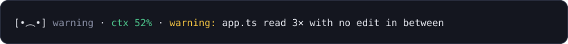

<p align="center">
  
</p>

<h1 align="center">token-lens</h1>

<p align="center">
  <b>See where your Claude Code tokens go, in plain words.</b><br>
  A <b>read-only</b> mod: live numbers, step-by-step tips when something wastes tokens, and <b>Lumi</b>, a pixel mascot whose mood follows your session.
</p>

<p align="center">
  Claude Code 2.1.287+ · English and Azərbaycan dili · MIT
</p>

<p align="center">
  
</p>

<table align="center">
  <tr>
    <td align="center"><br><sub>idle</sub></td>
    <td align="center"><br><sub>happy</sub></td>
    <td align="center"><br><sub>thinking</sub></td>
    <td align="center"><br><sub>worried</sub></td>
    <td align="center"><br><sub>alarmed</sub></td>
    <td align="center"><br><sub>sleepy</sub></td>
  </tr>
</table>

It never changes what Claude Code does. It never calls a model, never adds anything to Claude's context, never touches the system prompt, and makes no network, process or file-system calls.

- **Requires Claude Code 2.1.287 or later** (mods GA). Built and tested on **2.1.317**.
- Older builds don't run mods at all, so on them token-lens loads nothing and changes nothing.
- No manifest field can pin a minimum version. The requirement is stated here and in the plugin description.

---

## Install

At the prompt of a Claude Code terminal session:

```
/plugin install token-lens --marketplace aynurfarajova/token-lens
```

Answer `y` to add the marketplace, then pick a scope (user is first). From a shell:

```bash
claude plugin install token-lens --marketplace aynurfarajova/token-lens
```

In the desktop app, where `/plugin` doesn't run: click **+** next to the prompt box, then **Plugins**, then **Add marketplace** with `aynurfarajova/token-lens`, then **Add plugin**.

From a local folder, for one session:

```bash
claude --plugin-dir /path/to/token-lens
```

Where no flag can be given (a session the desktop app starts), set `CLAUDE_CODE_PLUGIN_DIRS` to the folder's absolute path. You can set it in your environment or in the `env` block of `~/.claude/settings.json`.

## Use

| Command | What it does |
|---|---|
| `/tokens` | Opens the pane. Only this opens it; the mod never opens a pane by itself. |
| `/tokens close` | Closes the pane. |
| `/tokens mute` / `unmute` | Silences or restores toasts. The setting is remembered. |
| `/tokens lang az` / `lang en` | Switches the language. The setting is remembered. |
| `/tokens reset` | Resets session and lifetime counts. |

`/tokens` runs immediately, even while a turn is streaming. It answers with no text, because a command's text becomes a transcript row Claude reads. Confirmations appear as toasts, which Claude never sees.

### What you see

<p align="center">
  
</p>

<p align="center">
  
</p>

- **Pane, Live tab:**
  - Lumi
  - a context bar with %, coloured; the % is always written too
  - the last request's **exact** total, broken down in plain words: reused from the saved part (cache read), saved for the next messages (cache write), new text (input) and Claude's answer (output), plus the reused share with a word for it (good ≥ 80%, fair ≥ 50%, low)
  - this turn's tokens, main vs subagents
  - session totals
  - notes whenever a figure is assumed
- **Pane, Tools tab:**
  - estimated tokens per tool type, always shown as `~12k`, with a plain word beside common tools (`Read (read file)`)
  - the 5 costliest calls, showing tool type and file name only
- **Pane, Tips tab:** each triggered rule with its severity in words and colour, the message, numbered steps to fix it, a repeat count, and a Dismiss button. Steps are written for people who are not developers: each is something you can do or say to Claude, and none puts the project at risk (no deleting, forcing, skipping tests or checks, or hiding errors; a test enforces this).
- **Band above the prompt:** one line with Lumi's text face, mood word, `ctx NN%`, and the latest warning. A `*` after the % means the window is still assumed. The band is drawn *under* whatever Claude Code or other mods already show there.
- **Toasts:** warnings only, never info. A toast shows the message and the first step only. Limited to one per rule per cooldown (default 10 min) and at most 5 per session, and `/tokens mute` silences them. None appear where nothing draws (`claude -p`).

Tabs also respond to keys `1`, `2` and `3` while the pane has focus.

### Lumi

Lumi is an **original character made for this repo**: a round teal drop with big eyes and an antenna holding a gold token coin. She isn't based on Anthropic's mascot or any other brand character. Every frame is drawn in code in `src/ui/mascot.ts`.

The moods, left to right in the gallery at the top:

| Mood | When | What she does |
|---|---|---|
| idle | nothing notable | open eyes, blinks |
| happy | efficient work: high cache hits, targeted searches, small edits | `^ ^` eyes, grin, cheeks, the coin bounces |
| thinking | a turn is running | glances up and around, the coin spins |
| worried | a warning in the last 2 min, or context ≥ 70% | brows up, frown, sweat drop |
| alarmed | a strong warning, or context ≥ 85% | wide eyes, `O` mouth, red coin, small shake |
| sleepy | idle long enough for the cache to cool | lids shut, the coin dims, a bubble drifts up |

How she's drawn on each surface:
- **Terminal:** a 16×8 grid of half-block characters, repainted with `$.ui.blit` only when the frame changes (2–6 fps, never above 8). Nothing else in the pane is redrawn.
  - Animation runs only while a terminal pane shows the Live tab. It stops by itself after 3 seconds of refused repaints.
- **Desktop, VS Code, mobile:** one SVG that steps through its frames itself, so the mod sends no updates.
- **Everywhere:** the mood word is written beside her, so colour or shape is never the only signal.
- Set `animation` off for one still frame (reduced motion).

---

## How the numbers work

**Exact** means a number the API reported. It's shown without `~`.

- `ctx = input_tokens + cache_read_input_tokens + cache_creation_input_tokens` of a request, read from `turn.step`'s `usage`.
- **Cache hit ratio** = `cache_read / ctx`.
- Main and subagent loops are counted separately: the key is `agentId`, or `main` for the main loop.

**Estimated** means a number the mod worked out. It's always shown with `~`. The API reports usage per *request*, never per tool. Between two requests of the same loop:

```
delta = max(0, ctx_n − ctx_{n−1} − output_{n−1})
```

`delta` is split across the tool results completed in between, in proportion to each result's size in characters. The split is capped at about 1.5× each tool's own size estimate (characters ÷ 4, plus 200), so a large reminder or attachment in the same delta isn't blamed on a small tool. The remainder is "other".

If there's no usable delta, each tool is estimated from its result size alone. That happens:
- on the first request
- after a compaction
- after `/clear`, `/resume` or `/branch`
- when the context didn't grow, for example because earlier thinking was dropped

**Edge cases handled:**
- **First request:** sets the baseline; nothing is attributed by delta.
- **Compaction (the context shrinks):** the baseline resets, and attribution is never negative.
- **`/clear`, `/resume`, `/branch` (fork):** re-baselined from `classic.SessionStart`'s `source`.
- **Interrupted request (`usage: null`):** nothing is measured; pending tool results wait for the next request.
- **Parallel tool batches:** all results completed since the last request share the split.
- **Garbage or missing usage values:** cleaned to non-negative integers.

**Assumptions, labelled as such in the UI:**
- **Context window:** 200k is assumed until the engine reports the real one (the `session.measure` event, after each main turn).
- **Prompt-cache lifetime:** 5 minutes is assumed unless a model-switch event reports `cache_ttl`.
- **Cache-rebuild cause (R5):** the API doesn't expose why the cache was missed, so the cause is inferred: compaction, model change, idle past the cache lifetime, or "cause unknown".

---

## Waste rules

Each rule is a heuristic, not a verdict. Thresholds are configurable.

| Rule | Fires when | Default | Severity | Why it exists | When it's fine to ignore |
|---|---|---|---|---|---|
| **R1** repeat-read | the same file is read N× in one loop with no edit or write to it in between | 3 | warn | Every re-read adds the whole file to context again. | The file really changed outside Claude (a build, a formatter), or different parts are read each time with offset/limit. Compaction resets the count. |
| **R2** huge-output | one tool result is estimated above N tokens | 8000 | warn | One verbose command (a full test log, `cat` of a big file) can fill a large share of the window. | You genuinely need the whole output, such as a failing test's complete trace. |
| **R3** full-file-read | a Read with no offset/limit is estimated above N tokens (below R2) | 5000 | info | Reading a range is usually enough once you know where to look. | First look at an unfamiliar file, or a file you'll edit throughout. |
| **R4** error-loop | N tool results in a row are errors | 3 | warn | Repeated failures usually mean Claude is guessing; each retry costs context. | Deliberate trial runs, such as probing which flag a CLI accepts. |
| **R5** cache-rebuild | a non-first request writes ≥ 4096 tokens to the cache, more than 2× its delta + 1024, while reading back under half of the previous context | — | warn (info after compaction) | Rebuilding the cache costs more than reading it. | After a compaction, a model switch or a long break, a rebuild is expected. |
| **R6** idle-cache-cooling | no request in the last minute before the cache lifetime ends | the lifetime (5 min assumed) | info | Sending the next message within the lifetime keeps the cache warm. | You're done or taking a break; the cost is one re-cache. |
| **R7** context-pressure | main context ≥ warn / ≥ strong of the window | 70% / 85% | warn / strong | Near the limit, compaction takes over and older detail is lost. | You're about to finish the task anyway. |
| **R8** subagent-heavy | subagents used over N of a turn's tokens (turns ≥ 10k tokens) | 50% | info | Subagents are powerful but not free. | Broad research or parallel exploration, which is exactly what subagents are for. |

**Positive signals** make Lumi happy: a cache hit ratio ≥ 0.8, targeted searches (Grep/Glob/LSP, or Bash `rg`/`grep`/`find`) with small results, and small successful edits.

Grep and Glob are not separate tools on the native macOS build, so searches arrive as Bash commands. token-lens reads only the command's first word to classify the call, and keeps none of it.

---

## Configuration

Set these in `/config` (each is a row there) or in `~/.claude/settings.json`:

```json
{ "pluginConfigs": { "token-lens": { "options": { "band": false, "max_toasts": 3 } } } }
```

| Option | Default | Meaning |
|---|---|---|
| `language` | `en` | `en` or `az`. `/tokens lang` overrides it. |
| `band` | `true` | Show the line above the prompt. |
| `animation` | `true` | Animate Lumi. Off shows one still frame. |
| `toasts` | `true` | Toast warnings. |
| `max_toasts` | `5` | Toasts per session (0–50). |
| `cooldown_minutes` | `10` | Minutes before the same rule may toast again. |
| `repeat_read_threshold` | `3` | R1 threshold. |
| `huge_output_tokens` | `8000` | R2 threshold. |
| `full_file_read_tokens` | `5000` | R3 threshold. |
| `error_loop_threshold` | `3` | R4 threshold. |
| `context_warn_percent` / `context_strong_percent` | `70` / `85` | R7 levels. |
| `subagent_share_percent` | `50` | R8 threshold. |
| `ring_size` | `500` | Tool calls kept in memory for the Tools tab (50–5000). |
| `lru_size` | `200` | Files remembered for R1 (20–2000). |

Out-of-range values are clamped and garbage falls back to the default. A bad setting never breaks the mod.

---

## Safety

Mods run unsandboxed with your permissions, so token-lens is written to be provably harmless.

- **Observe-only.**
  - `tool.call` awaits the engine's result and returns *that same object*. Its `.catch` hands back the same result and never refuses a call.
  - `turn.step` forwards every chunk and returns the engine's result.
  - Every other hook passes `e` through unchanged and returns what the engine returned. The `classic.*` hooks have a `.catch` that hands back the engine's own result.
  - There are no hooks on `tool.check`, `prompt.*`, `skill.prompt` or `session.compact`. The mod never approves or denies anything.
- **Zero token cost.** No model calls, no `context`, no prompt sections, and the system prompt is untouched, so the prompt cache stays warm. `/tokens` returns no text.
- **Fail-open.** All analysis runs inside a guard. An internal error leaves Claude Code exactly as it would be without the mod. It is reported as **one** dim transcript line per session, with the error's name only and details in `--debug`.
- **Time budget.** Hooks do constant work, or small linear work over bounded data. Timings measured in a real 2.1.317 session:

  | Hook | Time |
  |---|---|
  | `session.measure` | 0.4 ms |
  | `turn.complete` | 0.6 ms |
  | `classic.SessionStart` | 1.9 ms |
  | `session.start` | 5.4 ms |
  | `turn.start` | 6.4 ms |
  | `turn.step` | 12.6 ms |

  The engine's limit is 10 s.
- **Bounded memory.** Tool calls live in a ring buffer (500), the R1 file counter is an LRU (200), and tool types (64), tips (20), loops (64) and pending results per loop (256) are all capped.
- **Untrusted text is cleaned.** File names, tool names and MCP server names can come from outside: a repo's files, or an MCP server. Before they're kept or shown they pass through `cleanLabel`, which:
  - strips terminal control characters and escape sequences, including OSC 8 hyperlinks and newlines
  - strips Unicode direction overrides and zero-width characters
  - caps the length

  Nothing is drawn as Markdown or as a link. Paths kept in memory and commands read for classification are bounded (1024 and 512 characters).
- **No dependencies.** There's no `package.json` and nothing downloaded or installed. The code imports only its own files, `claude-code` (types only) and, in tests, `claude-code/testing`.
- **Redraw limits.** Pane and band updates are grouped into one state write per 250 ms. The engine allows ≤ 10/s, or 30/s for a terminal pane. Repaints of Lumi stay ≤ 8/s against an engine limit of 120/s.

### Permissions: what `claude plugin validate` reports

```
claude plugin validate .   # Claude Code 2.1.317; result: ✔ Validation passed

Validating plugin manifest: .claude-plugin/plugin.json

  ❯ types ./types/index.d.ts declares on $: nothing (no EngineInterface member)
  ❯ types ./types/index.d.ts declares state: token-lens.view, token-lens.tab

Validating hooks: hooks/hooks.json

  ❯ ./register.tsx hooks: session.start, session.end, classic.SessionStart, classic.PostCompact, classic.PostModelSwitch, session.measure, turn.start, turn.step, turn.complete, tool.call, command.run{command=tokens}, ui.render{component=Pane, requestId=token-lens}, ui.render{component=AbovePrompt}
  ❯ ./register.tsx answers its own command: command.run{command=tokens}
  ❯ ./register.tsx gating hook with .catch: classic.SessionStart
  ❯ ./register.tsx gating hook with .catch: classic.PostCompact
  ❯ ./register.tsx gating hook with .catch: classic.PostModelSwitch
  ❯ ./register.tsx gating hook with .catch: tool.call
  ❯ ./register.tsx calls: $.clock.after, $.clock.every, $.clock.now, $.command.register, $.state.get, $.state.set, $.store.delete, $.store.get, $.store.set, $.ui.blit, $.ui.close, $.ui.log, $.ui.open, $.ui.panes, $.ui.resolve, $.ui.toast
  ❯ ./register.tsx state writes: token-lens.tab, token-lens.view
  ❯ ./register.tsx state reads: token-lens.tab, token-lens.view
```

The calls are UI, command, store, clock and `$.state`. `$.state` is the session-local value the pane and band redraw from. There are no `model`, `http`, `process`, `fs`, `env`, `settings` or `session.*` calls.

### Privacy

- **Never stored:** tool arguments, tool output, prompts, file contents, environment variables.
  - A tool's arguments are read in memory only to classify the call: is it a read, an edit or a search, and does it have a line range.
  - Output is used only for its **length**.
- **File paths** stay in memory only, for R1 repeat-read detection. They're shown as basenames only and never persisted. That is stricter than storing a hash.
- **Persisted in `$.store`:**
  - `aggregates-v1`: counts only, namely calls, estimated tokens and errors per tool type; exact token totals for main and subagents; and how many times each rule fired.
  - `prefs-v1`: `language` and `muted`.

  A test checks that no path, argument or output ever reaches the store.

### Disable it

- **For a `--plugin-dir` run:** start Claude Code without the flag, or remove the folder from `CLAUDE_CODE_PLUGIN_DIRS`.
- **When installed:** `/plugin`, then disable, or `claude plugin disable token-lens`.
- **Everything at once:** `claude --safe-mode`, or `CLAUDE_CODE_SAFE_MODE=1`, starts with all customisations off.
- **Partly:** turn off `band`, `toasts` or `animation` in `/config`, or run `/tokens mute`.

---

## Limits and known gaps

- **Per-tool numbers are estimates.** They come from size-weighted shares of each request's growth. Anything a tool adds that isn't visible in its result text counts as "other".
- **Refused tool calls may not be counted.** A call refused by a permission rule or another plugin *before* it reaches the engine may never reach token-lens's `tool.call`, so it may not count toward R4.
- **Cache details:** the cache lifetime and the reason for a cache miss are not given to mods in general. The lifetime is assumed to be 5 min unless a model switch states it, and R5's cause is inferred.
- **Context window:** assumed to be 200k until the first `session.measure`, marked `*` in the band and "assumed" in the pane.
- **Subagent tokens per turn** are counted while a main turn runs. R8 uses them.
- **Reloads:** a hot reload of the mod restarts its in-memory state. Lifetime counts are saved about once a minute and at session end, so at most about a minute of lifetime counts can be lost.
- **No UI in `claude -p`:** the hooks still observe and the stored counts still update, but no toasts are shown.
- **The band** is drawn on the terminal and desktop surfaces only; the engine raises it nowhere else. The pane works on all four surfaces.

---

## Development

```
token-lens/
├── .claude-plugin/plugin.json   manifest, userConfig, icon.png
├── hooks/hooks.json             { "modules": ["./register.tsx"] }
├── hooks/register.tsx           wiring only: events → core → UI
├── src/core/                    pure logic (no `$`): ledger, attribution, rules, mood,
│                                tracker, view, config, safe (the guard), format
├── src/ui/                      pane, band, mascot, faces, text
├── src/i18n/                    en, az (the types make az carry every English key)
├── types/index.d.ts             the $.state contract (PluginState)
├── test/                        unit tests and mod-kit tests (world.tsx is the fake engine)
└── docs/                        README previews of Lumi and the pane (SVG), and previews.mts
```

The previews are drawn from the mod's own sprites. After changing `src/ui/mascot.ts`, redraw them (Node 22.18 or later):

```bash
node docs/previews.mts .
```

```bash
claude plugin test .
```

```bash
claude plugin validate .
```

**66 tests in 6 files.** They cover:
- attribution fixtures: normal turn, parallel tools, compaction, `/clear`, error loop, subagents, missing usage, negative deltas
- rules, mood, ledger and config
- pass-through: `tool.call` and `turn.step` return the same results, including with fault injection
- the pane on terminal, desktop, vscode and mobile
- the band
- toast limits
- the mascot's frames, encoders and repaint rate
- privacy of what's stored
- hardening of names that come from outside

### Manual smoke test

1. Run `claude --plugin-dir /path/to/token-lens` and confirm there's no `token-lens:` error line.
2. Ask something that reads a file 3 times. The band should turn worried, and `/tokens` → Tips should show R1.
3. Compare Live with `/usage` and the statusline. The last request's input, cache read, cache write and output should match exactly, and context % should match once the window is measured.
4. Run `/compact`, then check that the next request isn't flagged and nothing negative appears. Repeat with `/clear` and `--resume`: the counters re-baseline.
5. Run a command with large output (`cat` a big file through Bash): R2 should toast once, and the second time within 10 min it shouldn't.
6. Check `/tokens mute`, `/tokens lang az`, `/tokens close`, and turning off `band` and `animation` in `/config`.
7. Check that Lumi animates in the terminal pane and stops when you switch tabs.

---

## License

MIT © 2026 Aynur Farajova. See [LICENSE](LICENSE). Lumi is part of this project and covered by the same license.
